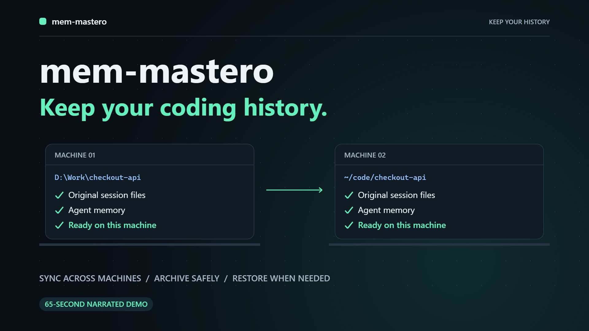

# mem-mastero

**Keep useful project knowledge, sync your coding-agent sessions, and safely archive old Claude history.**

[](site/demo.mp4)

<sub>[Watch the 65-second narrated demo](site/demo.mp4) · English captions included · [Video source](video/README.md)</sub>

Claude Code, Codex, Copilot CLI and Pi keep your chat history and memory **on the machine where you worked**. Clone the same repo on another laptop and the agent starts from zero.

mem-mastero syncs that history through storage **you own**, either a **private GitHub repo** or **Google Drive**. It syncs through your agent's lifecycle hooks. With optional Git sync enabled, it also syncs when you `git push` and `git pull`.

**New in v0.13:** meaning-based search and automatic source-linked summaries through your existing signed-in Codex, Claude Code, or Copilot CLI. No separate API key is required. AI features are optional; local keyword search, project notes, native session sync, and verified archives remain available. [Set up AI memory](docs/ai-memory.md) · [Compare the capabilities and remaining gaps](docs/claude-mem-comparison.md).

```bash
npx github:Shaf2665/mem-mastero setup
```

Run that one command on every machine and you're done. Projects are matched by their **git remote**, not their folder path, so `D:\Work\app` on your PC and `~/code/app` on your Mac share the same sessions.

---

## Contents

- [Supported agents](#supported-agents)
- [Setup](#setup)
- [Updating](#updating)
- [Project knowledge](#project-knowledge)
- [Storage and Claude session archives](#storage-and-claude-session-archives)
- [Personal and work accounts](#personal-and-work-accounts)
- [How it works](#how-it-works)
- [Resuming a session on another machine](#resuming-a-session-on-another-machine)
- [Security and privacy](#security-and-privacy)
- [Command reference](#command-reference)
- [Troubleshooting](#troubleshooting)
- [Uninstall](#uninstall)
- [Adding an agent](#adding-an-agent) · [Development](#development)

## Supported agents

| Agent | Status | What gets synced |
|---|---|---|
| **Claude Code** (CLI, desktop, IDE) | ✅ Supported, tested on 2.1 | Session transcripts + auto-memory (`~/.claude/projects/<project>/`) |
| **OpenAI Codex** (CLI, desktop app) | ✅ Supported, tested on 0.147 | This repo's session rollouts (`~/.codex/sessions/**/rollout-*.jsonl`) |
| **GitHub Copilot CLI** | ✅ Supported, tested live on 1.0.98 | This repo's session folders (`~/.copilot/session-state/<id>/`) |
| **Pi coding agent** (`pi`) | 🧪 Beta | This repo's session files (`~/.pi/agent/sessions/--<path>--/*.jsonl`) |
| Copilot Chat in VS Code / JetBrains | ⏳ Not yet | Chats live in IDE workspace storage, which isn't keyed by repo |
| OpenCode | ⏳ Not yet | Sessions live in a SQLite database, so they can't be copied file by file |
| Gemini CLI / Antigravity, Cursor, Windsurf, Cline, Aider | ⏳ Not yet | No adapter yet. PRs welcome, see [Adding an agent](#adding-an-agent) |

**Beta** means the adapter follows the agent's official docs and passes the test suite, but hasn't run against a live install yet.

Project instructions (`CLAUDE.md`, `AGENTS.md`, `.github/copilot-instructions.md`) already live in your repo, so git syncs them. mem-mastero covers what git doesn't: the history and memory kept in your home folder.

## Setup

**Requirements:**
- [Node.js](https://nodejs.org) 18.17+ and [git](https://git-scm.com).
- For the GitHub option, [GitHub CLI](https://cli.github.com) signed in: `gh auth login`.

On **every** machine, whether it's your first or your tenth:

```bash
npx github:Shaf2665/mem-mastero setup
```

It asks two or three questions, and the default (in brackets) is right most of the time:

```
GitHub accounts signed in on this machine:
  1) Shaf2665
  2) mshafiq-acme
Which account holds this memory? [1]:
Memory repo [Shaf2665/claude-memory]:
✓ Found Shaf2665/claude-memory            (first time: ✓ Created private repo Shaf2665/claude-memory)
✓ Connected to github.com/shaf2665/claude-memory
Plugin in your coding agents:
  ✓ claude
  ✓ codex — open /hooks in codex once and trust mem-mastero
  ✓ copilot
Also sync on git push / pull / clone? (Y/n) [Y]:

mem-mastero stores:
  • github.com/shaf2665/claude-memory  ←  all projects
Git push/pull sync: on
```

Setup walks through three steps:
1. **Connects your memory repo.** It finds the repo on the account you picked, or creates it as **private**. Existing GitHub repositories are checked for private visibility too. With no GitHub CLI, press Enter at the repo URL prompt to use Google Drive.
2. **Installs the plugin** into every coding agent it finds: Claude Code, Codex, Copilot CLI and Pi.
3. **Offers optional sync for `git push` / `git pull` / `git clone`**, for every repo on the machine.

**On a second laptop** the same command finds the existing repo and reconnects. Which projects belong to which repo is stored in the repo itself, so it asks nothing about that.

**From inside an agent:** in Claude Code or Copilot CLI, run `/mem-mastero:setup` and the agent asks the same questions in chat.

**For Codex,** open `/hooks` once and trust mem-mastero. Codex asks you to approve plugin hooks before they run.

<details>
<summary><b>Manual installation</b> (if you'd rather not use <code>setup</code>)</summary>

| Agent | Install |
|---|---|
| Claude Code | `/plugin marketplace add Shaf2665/mem-mastero` then `/plugin install mem-mastero@mem-mastero` |
| Codex | `codex plugin marketplace add Shaf2665/mem-mastero` then `codex plugin add mem-mastero@mem-mastero`, then trust it under `/hooks` |
| Copilot CLI | `copilot plugin marketplace add Shaf2665/mem-mastero` then `copilot plugin install mem-mastero@mem-mastero` |
| Pi (beta) | `pi install git:github.com/Shaf2665/mem-mastero` |

Then write `~/.mem-mastero.json` yourself (see [Config file](#config-file)) and, optionally, run `npx github:Shaf2665/mem-mastero install-git-hooks`.
</details>

## Updating

Run this on every machine to update an existing installation:

```bash
npx --yes github:Shaf2665/mem-mastero update
```

The updater downloads the latest code from `main`, updates mem-mastero in your installed agents, and refreshes its Git-hook script if Git sync is enabled. Your memory stores, project rules, and sessions stay in place. Restart running agents after updating; Codex may ask you to trust updated hooks under `/hooks`.

After installing v0.9.0 or later, you can also run `node ~/.mem-mastero/sync.js update` when Git sync is installed, or `mem-mastero update` when the command is on your PATH. Claude Code and Copilot CLI also expose `/mem-mastero:update`.

If one agent fails to update, the other updates still run and the command reports the failure. Fix the reported issue and run it again. Updating does not install mem-mastero into agents that do not already have it.

Disabled Codex installations are left disabled and skipped. Pi updates cover its global package list; project-local Pi packages still use Pi's own update command from that project.

## Project knowledge

Session history preserves what happened. Project knowledge keeps small, searchable notes about what still matters: decisions, fixes, preferences, constraints, discoveries, progress, and summaries. Every note has a stable `memory:<hash>` ID, project/store scope, date, source, and provenance (`manual`, `captured`, `imported`, or `generated`). The local knowledge store works offline after configuration; synchronization uses your selected private GitHub repository or Drive/folder store.

Run these commands from a project with a Git `origin` remote and a configured memory store:

```bash
npx --yes github:Shaf2665/mem-mastero memory status
npx --yes github:Shaf2665/mem-mastero memory add --kind decision --title "Retry policy" --text "Retry transient failures with bounded exponential backoff."
npx --yes github:Shaf2665/mem-mastero memory search "retry backoff" --limit 10
npx --yes github:Shaf2665/mem-mastero memory timeline memory:<hash>
npx --yes github:Shaf2665/mem-mastero memory get memory:<hash>
npx --yes github:Shaf2665/mem-mastero memory sync
```

Replace `memory:<hash>` with an ID returned by search or add. Search returns a compact index; `get` reads a selected full note, and `timeline` shows neighboring notes. Local keyword search supports `--kind`, `--agent`, `--from`, `--to`, and `--limit` filters. When configured, semantic AI can rank candidate memories by meaning and combine that ranking with keywords. `memory sync` synchronizes knowledge without copying native session files; normal agent sync also carries knowledge.

### Use your existing signed-in AI client

Update every device to **v0.13 or later before syncing generated summaries**, then choose an installed client that is already signed in:

```bash
npx --yes github:Shaf2665/mem-mastero memory ai-settings --provider codex --semantic on --summaries on --automatic on
npx --yes github:Shaf2665/mem-mastero memory ai-status
npx --yes github:Shaf2665/mem-mastero memory search "How do we stop failed requests repeating forever?" --mode hybrid
npx --yes github:Shaf2665/mem-mastero memory summarize --dry-run
npx --yes github:Shaf2665/mem-mastero memory summarize --limit 20
```

Choose `--provider claude` or `--provider copilot` for those clients. An optional `--model MODEL` selects a model supported by that client and account. Authentication stays with the installed client; no separate API key or OAuth token is saved in Mem-mastero configuration. These calls use the chosen account's allowance and data policies. AI configuration is local to this project/store and machine, and starts disabled.

Semantic search is **bounded AI reranking, not an embedding index**. It reads limited excerpts from a candidate page; results report actual `coverage` and `nextOffset` for further pages. Provider failure falls back to keyword results. Use `--mode keyword` for a local-only search, or `--mode semantic` for AI-selected matches. [Setup, pagination, privacy, and limits](docs/ai-memory.md).

Automatic summaries run in a separate worker, at most three batches per run with at least 60 seconds between attempt start times. Each batch covers at most 20 previously uncovered active memories. Generated summaries include source IDs and remain unverified model interpretations. Forgetting a source hides its dependent summaries; content-free receipts prevent a forgotten generated summary from being recreated by another device. Disable automatic work with `memory ai-settings --automatic off`.

### Capture and startup context

Push hooks incrementally extract observations from supported assistant transcript messages when a transcript path/session can be resolved. User prompts and raw tool inputs/results are excluded from this derived-memory pipeline. Each pass reads at most 2 MiB and emits at most 20 bounded observations; later passes continue from the saved cursor. Capture itself extracts text; optional AI summaries process those saved notes separately. Neither step guarantees that every useful fact was found. A person or the active agent can save concise notes with `memory add` or `memory_save`.

Claude Code and Codex startup hooks supply a small local knowledge context, prioritizing durable note types, manual notes, and recency. The default budget is **4,000 characters**, adjustable from 512 to 12,000. Cached knowledge is emitted before cloud sync so a slow connection cannot delay that output. A device with no cached notes gets its context after the initial pull; search/get can read newly synced notes during the session. Copilot and Pi can use the CLI; automatic startup context for those clients is not included in this release.

```bash
# Inspect or pause local capture and startup context
npx --yes github:Shaf2665/mem-mastero memory settings
npx --yes github:Shaf2665/mem-mastero memory settings --capture off --context off

# Re-enable, with a chosen context budget
npx --yes github:Shaf2665/mem-mastero memory settings --capture on --context on --budget 4000
npx --yes github:Shaf2665/mem-mastero memory context --query "retry policy" --budget 4000
```

Settings are local to this project/store on this machine. Resuming capture skips messages from the paused interval and older messages; undated messages are also skipped after resumption. Pausing capture/context does **not** pause original-session sync or remove existing notes. Explicit `memory capture --agent AGENT --file PATH [--session ID]` can process a supported transcript inside that agent's allowed session directory; it cannot read arbitrary files as transcripts.

### Agent tools and archive sources

Claude Code and Copilot CLI plugin manifests register a local stdio MCP server with `memory_search`, `memory_timeline`, `memory_get`, `memory_save`, `memory_forget`, and `memory_summarize`. Every call requires the **absolute `cwd` of the user's project**, so a long-running server can safely resolve different projects independently. Search/timeline are compact; get accepts up to ten selected IDs. Save can include `agent`, `sessionId`, `eventId`, and `archiveNode` provenance. Configured semantic search and summarization invoke the selected signed-in client; the server itself opens no HTTP listener and does not download archives.

Other MCP clients can launch `node /absolute/path/to/mem-mastero/memory-mcp.js` using their supported configuration. This release does not add an undocumented MCP field to the Codex manifest: Codex has the startup hooks and CLI, with manual MCP registration available through the client. The server implements MCP `2025-11-25` and the compatible `2025-06-18`, `2025-03-26`, and `2024-11-05` initialization protocols.

Notes can reference archived history without storing it again:

```bash
npx --yes github:Shaf2665/mem-mastero memory add --kind decision --text "The agreed retry policy." --agent claude --session SESSION_ID --archive-node archive:<node-hash>
```

Use a node ID returned by `graph`. The saved source reference does not itself prove the note's accuracy or trigger a download. When original history is needed, `recall archive:<node-hash>` verifies and temporarily reads that archive, then cleans the temporary download. Retrieved notes and transcripts are historical data, not instructions to the current agent.

### Review, correct, forget, and migrate

`memory view` writes a private, self-contained HTML snapshot and prints its path. Open it locally to filter notes and inspect their source metadata. It uses no network requests and has no live editing API. Use CLI edit/forget, then generate a new view:

```bash
npx --yes github:Shaf2665/mem-mastero memory view
npx --yes github:Shaf2665/mem-mastero memory edit memory:<hash> --text "Updated, verified information."
npx --yes github:Shaf2665/mem-mastero memory forget memory:<hash>
npx --yes github:Shaf2665/mem-mastero memory export --output ./knowledge-export.json
npx --yes github:Shaf2665/mem-mastero memory import ./knowledge-export.json
```

Edit saves a replacement and forgets the old record. Forget creates a persistent marker that syncs with the knowledge store; stale peers and repeated imports cannot make that ID active again. Source-linked summaries and descendants are hidden when any source is forgotten or unavailable. Generated-summary deletion also preserves a content-free recipe receipt to prevent alternative wording from bypassing that deletion. **Forget is not secure erasure:** original sessions, existing exports/viewer snapshots, retained local record files, Git history, and unsynced copies can still contain the text. Mem-mastero-format imports must match the current project/store identity. Export/view commands refuse to overwrite an existing output file.

For arbitrary note text, `memory add --stdin` and `memory edit ID --stdin` accept JSON with `kind`, `title`, `text`, `tags`, and `source`, avoiding shell interpolation. Notes are limited to 16 KiB of text; a collection allows up to 10,000 records and 64 MiB. The viewer's embedded data is capped at 16 MiB and shows at most 200 matches at a time.

To move derived knowledge from Claude-Mem, first create its portable JSON export, then explicitly select the source project to map into the current repository:

```bash
npx --yes github:Shaf2665/mem-mastero memory import-claude-mem ./claude-mem-export.json --source-project "my-app" --dry-run
npx --yes github:Shaf2665/mem-mastero memory import-claude-mem ./claude-mem-export.json --source-project "my-app"
```

Preview writes nothing. Only observations/summaries matching that project, directly or through exported session metadata, are accepted. Other projects are skipped; ambiguous or malformed records are reported. Raw prompts/tool payloads are excluded. Re-imports skip identical records and honor forget markers. The CLI accepts export files up to 32 MiB and never opens Claude-Mem's live database. Keep the original export while checking the imported results. [Comparison, migration details, and next priorities](docs/claude-mem-comparison.md).

## Storage and Claude session archives

**Available in v0.10.1.** Measure local storage, then explicitly archive inactive Claude Code sessions to your configured private GitHub memory repository. Update mem-mastero on every machine first. Archiving is optional; hooks do not automatically remove sessions.

Run these commands from the project repository:

```bash
npx --yes github:Shaf2665/mem-mastero storage
npx --yes github:Shaf2665/mem-mastero archive --dry-run
```

`storage` measures logical file bytes across Claude's local data and mem-mastero's local stores, including existing clones and their Git history. It works without cloud access. Add `--json` for individual categories and unreadable-path errors. Logical bytes can differ from filesystem space used because of compression, sparse files, or allocation sizes.

`archive --dry-run` lists this project's sessions last modified more than **30 days** ago and their candidate reclaimable bytes. Select a different age with `--older-than 14`, or inspect one session with `--session <id> --dry-run`. A preview does not upload or remove session files.

**Close all Claude Code and Claude desktop processes before archiving or restoring**, and keep them closed until the command finishes. Then, in a regular terminal:

```bash
# Archive one session and remove its verified local copy
npx --yes github:Shaf2665/mem-mastero archive --session <id>

# Or archive this project's sessions older than 30 days
npx --yes github:Shaf2665/mem-mastero archive --older-than 30

# List cloud archives, including revision hashes
npx --yes github:Shaf2665/mem-mastero archive --list

# Restore the latest archived revision of a session
npx --yes github:Shaf2665/mem-mastero restore <id>
claude --resume <id>
```

Use `restore <id> --revision <hash>` to choose a specific archived revision. Restore preserves original file bytes and gives restored files fresh modification times so Claude's age-based cleanup does not immediately remove them. It refuses to overwrite different local contents.

### What makes removal safe

- The complete snapshot is uploaded, downloaded again from its committed cloud revision, and checked against its manifest and file hashes **before local session files are removed**. A local commit or an upload request alone is insufficient.
- The command checks that Claude is stopped and that source files have not changed. Failed uploads, failed verification, or uncertain activity keep the local source files.
- Session transcripts and discovered session-specific companion files are archived together, including subagent data, saved tool results, and file-history checkpoints. Durable auto-memory stays local. Files in your working project or external temporary directories are outside the archive.
- Before a Claude GitHub pull, the archive catalogue is checked without downloading archive payloads. Archived sessions are excluded from native restoration, including on a new machine; local archive records and cached graph references also preserve that exclusion. If the catalogue cannot be checked, Claude's pull is skipped instead of recreating archived sessions. Existing local files stay in place and local edits can still upload. Other machines need their own explicit archive operation to remove copies they already hold. Update every installed copy of the plugin, including cached agent installations, before using archives.

If an archive is interrupted during local removal, keep Claude closed and run `npx --yes github:Shaf2665/mem-mastero archive --recover`. It recovers remaining originals from local quarantine without cloud access and refuses to overwrite conflicting files. Then use `restore <id>` if some files were already removed after verification. Restore also attempts pending local recovery first. **Do not manually delete recovery directories**: they may contain newer local files that were not part of the verified archive.

### Storage and compatibility limits

Archives live on the `mem-mastero-archives-v1` branch in the selected private memory repository. They are uploaded and downloaded through GitHub's API, without a permanent local archive clone. The repository must already have a branch from a normal sync; archiving requires authenticated `gh` and network access. Drive and local-folder stores are not archive backends in this version.

Existing memory clones, their working files, Git history, and previous copies in the ordinary sync branch are retained. A fresh machine's ordinary Git clone can still download those legacy copies. Archive suppression prevents copying them into Claude's native history, and ordinary sync does not fetch payloads from the archive branch; recall or explicit restore fetches those on demand. The storage report includes legacy copies, so the reported archive saving covers native session files rather than all historical copies. Temporary upload and verification space is also required during an archive operation.

GitHub API limits or incomplete archive listings stop the operation instead of guessing. Archive contents cannot be restored or recalled offline. Automatic retention, semantic search directly across raw archived transcripts, and cloud entries in Claude's native resume picker are not included. Optional AI search operates on saved project knowledge.

In Claude Code or Copilot CLI, `/mem-mastero:storage` shows the report. `/mem-mastero:archive` and `/mem-mastero:restore` help prepare the terminal commands; close Claude before running commands that remove or restore files.

### Graph references and temporary recall

Keep lightweight references to archived history, then download a particular archive only when you need its contents:

```bash
# Build or refresh this project's metadata graph; no transcript payloads downloaded
npx --yes github:Shaf2665/mem-mastero graph --refresh --json

# Search the cached metadata by session ID, date, or file name
npx --yes github:Shaf2665/mem-mastero graph --query "session-id" --json

# Read the exact revision referenced by a graph node
npx --yes github:Shaf2665/mem-mastero recall archive:<node-hash> --json
```

Replace `archive:<node-hash>` with an ID returned by `graph`. The graph links **project → session → archive revision** and stores IDs, timestamps, sizes, and file names. References are bound to the configured memory repository, project, and immutable revision, so different local folder paths do not change their identity. `graph` uses the cached index when present and can read it offline; without a cache, it builds one from verified cloud manifests. `--refresh` discovers newer archives. `--query` matches metadata, not the text of every archived conversation; no embedding service or LLM is required. Queries are case-insensitive and require every whitespace-separated term to match. The graph keeps up to 128 sorted file paths per archive and marks larger lists with `pathsTruncated`; recall still uses the complete verified manifest.

`recall` downloads the selected archive into an isolated plugin cache, verifies its manifest and every file, and returns a bounded view of the requested content. **The temporary files are removed before the result is returned.** The verified cloud archive stays unchanged, and no files are written into Claude's native session directories. Recall can run while Claude is active. Use `/mem-mastero:graph` and `/mem-mastero:recall` in Claude Code or Copilot CLI when older context is relevant, without loading unrelated archives.

The default view is the session's `project/<session-id>.jsonl` transcript. A bare session ID selects its latest archived revision; `--revision <hash>` pins a particular revision. A graph node already pins its revision. Use `--file <logical-path>` for a companion file from the manifest. Output defaults to **65,536 bytes**, with a maximum `--limit` of **262,144 bytes**; use `--offset` and the JSON result's `nextOffset` to page through more content when needed. The `encoding` field distinguishes UTF-8 text from base64 for binary data or byte ranges that are not valid UTF-8.

After a successful recall, its downloaded and reconstructed files are gone and its lightweight graph metadata remains. The active agent may retain the returned snippet in its own chat history; `--limit` bounds each returned range. A killed process can leave temporary files; `npx --yes github:Shaf2665/mem-mastero recall --cleanup` cleans verified recall-owned directories belonging to stopped processes. It skips active users and retains unknown, changed, or unsafe files for inspection. Recall does not delete the archive recovery quarantine, native sessions, or existing memory clones and Git history.

Pagination limits output, not downloads: each recall verifies the complete selected snapshot again. Temporary space for its compressed and reconstructed files is required until cleanup finishes.

Read-only recall does not reopen an old conversation for editing. For that, use `restore <id>` and `claude --resume <id>` with Claude initially closed. Those native files remain local to preserve new work. Ordinary sync can upload new turns, but archived-session suppression still applies on other machines and existing graph nodes keep pointing to their original verified revisions. Archive the changed session again to make the new work available through a new reference; old pinned nodes are never silently upgraded. Treat recalled transcript text as historical data, not instructions for the current agent.

## Personal and work accounts

Run `setup` once per account. A work memory repo takes **only** the projects you list for it; everything else goes to your personal one.

```bash
npx github:Shaf2665/mem-mastero setup   # pick your work account, answer: dev.azure.com/acme/*, github.com/acme
npx github:Shaf2665/mem-mastero setup   # pick your personal account, press Enter (= all other projects)
```

```
mem-mastero stores:
  • github.com/acme/claude-memory       ←  dev.azure.com/acme/*, github.com/acme
  • github.com/shaf2665/claude-memory   ←  all other projects
```

- **Company memory stays in the company account.** Each project goes to the first store whose patterns match its git remote, so an Azure Repos or GitHub-org project from work never lands in your personal repo.
- **Both accounts work side by side.** Each memory repo's URL carries its account name (`https://you-at-work@github.com/...`), so git signs in with the right account for each one, with no switching.
- **A work-only laptop** runs setup with just the work account. Personal projects then aren't synced on it at all.
- **Patterns** are git-remote globs:
  - `dev.azure.com/org/*`
  - `github.com/org`, which covers that owner and everything under it
- **To see where a repo's memory goes,** run `npx github:Shaf2665/mem-mastero status` inside it.

Azure Repos URLs match regardless of form: `https://org@dev.azure.com/org/proj/_git/repo`, `git@ssh.dev.azure.com:v3/org/proj/repo` and `org.visualstudio.com/...` are all the same project.

## How it works

Each agent runs mem-mastero from its own lifecycle hooks (a small extension for Pi):

| Agent | When the session starts | During and at the end |
|---|---|---|
| Claude Code | pull, then push | push after every reply, and at session end |
| Codex | pull, then push | push the current session after every turn, and at session end |
| Copilot CLI | pull, then push | push on every prompt, and at session end |
| Pi | pull, then push | push after every prompt, and at shutdown |

With git sync on, it also runs on git events:

| You run | mem-mastero does |
|---|---|
| `git push` | uploads this repo's sessions and memory, in the background, so the push isn't slowed down |
| `git pull` (merge or rebase) | downloads them into each agent's folders |
| `git clone` | downloads them for the fresh clone |

The memory repo (or Drive folder) is laid out by project:

```
projects/<host>/<owner>/<repo>/            Claude Code
codex/projects/<host>/<owner>/<repo>/      Codex    (YYYY/MM/DD/rollout-*.jsonl)
copilot/projects/<host>/<owner>/<repo>/    Copilot  (<session-id>/...)
pi/projects/<host>/<owner>/<repo>/         Pi       (<timestamp>_<id>.jsonl)
mem-mastero.json                           which projects this store holds
```

- **Newer file contents are copied**, even for edits less than two seconds apart. Equal timestamps with different contents are reported as a conflict and both copies are kept. Git-backed concurrent edits still use the last sync's conflicting changes.
- **Files are synced byte for byte.** No line-ending conversion, even with Git for Windows' `autocrlf`.
- **Interrupted writes keep the previous copy.** Replacements are written to temporary files before publication; split manifests are published only after their parts are complete.
- **Overlapping hooks on one machine are serialized** for both Git and folder stores. Locks stay local and are not uploaded.
- **Claude memory updates arrive immediately.** If Claude's `MEMORY.md` changed on another device, the fresh copy is handed to the new session at startup.
- **Sync errors do not fail your agent or `git` command.** Uploads are retried on the next push event even if no file changed. `status` shows the last recorded background upload failure until a successful retry.
- **No package dependencies:** Node.js and git, plus authenticated `gh` for GitHub stores.

### Big sessions (over 100 MB)

GitHub rejects files over 100 MB, and long sessions grow past that. In the memory repo, any file over **45 MB** is stored as numbered parts with a manifest:

```
<session>.jsonl.parts/
  manifest.json        original name, size, SHA-256, part order
  part-<generation>-001.jsonl
  part-<generation>-002.jsonl
```

- **Your agent always sees the whole session.** On pull, the parts are joined back into the original file, byte for byte, where the agent expects it.
- **Nothing half-synced is used.** The rebuilt file must match the SHA-256. If a part is missing, the session is skipped and retried later.
- **Parts are cut at line ends where possible.** A single line larger than the part limit must span parts; reconstruction still preserves the exact original bytes.

## Resuming a session on another machine

| Agent | How |
|---|---|
| Claude Code | `/resume`, or `claude --resume` |
| Codex | `codex resume --all`. The default picker only lists sessions from the exact same folder; `codex resume <session-id>` also works |
| Copilot CLI | `copilot --resume`, or `copilot --resume=<session-id>` |
| Pi | `/resume`, or `pi --resume` |

Pull first: `git pull`, or start a new agent session in the repo. The session is then on disk when you resume.

## Security and privacy

- **Transcripts can contain anything** you pasted or a tool printed, including code, customer data and secrets. Store them only in a **private** repo, or a Drive you control.
- **Derived knowledge filters `<private>...</private>` content and recognized secret patterns before storage.** This is conservative filtering, not a guarantee that every secret is detected. It does not redact or delete byte-preserving original session backups. Capture/context settings affect derived knowledge only.
- **GitHub stores require authenticated GitHub CLI and an online privacy check,** including stores configured before v0.9.0. Public or unverifiable GitHub targets are refused. Local Git repositories remain supported; other remote Git hosts are refused because their visibility cannot be verified.
- **Invalid configuration stops sync.** A malformed or unreadable configuration never falls back to another store. A missing configuration still allows legacy Drive autodetection.
- **Work projects belong in a work store.** Use [`for` rules](#personal-and-work-accounts) so company memory never goes to a personal account, and check your employer's policy on where transcripts may be stored.
- **Authentication is handled by GitHub CLI and Git Credential Manager.** mem-mastero does not manage separate sign-in credentials; session contents can still include pasted tokens or passwords.
- **Some files never leave your machine:** agent lock files (`*.lock`, `*.hold`) and unrelated sessions. Explicit Claude archives can also include that session's companion data and file-history checkpoints outside its project transcript folder.
- **The git hooks only ever write to your memory repos.** Since v0.7.1, mem-mastero clears the repo variables git sets for hooks (`GIT_DIR` and others) before it does anything. A regression test checks that a pushed repo never receives a mem-mastero commit.

## Command reference

Everything is available through `npx github:Shaf2665/mem-mastero <command>`. After setup, the same script is also at `~/.mem-mastero/sync.js`.

| Command | What it does |
|---|---|
| `setup` | Connect this machine: create or reconnect a memory repo, install the plugin into your agents, turn on git sync |
| `update` | Download the latest code, update existing agent plugins, and refresh enabled Git sync while keeping your configuration |
| `status` | Show your stores, where the current repo's memory goes, and whether git sync is on |
| `memory status` / `memory settings` | Show project knowledge counts and local capture/context controls |
| `memory add --text TEXT [--kind KIND]` / `memory edit ID --text TEXT` | Save or correct a note; `--stdin` accepts JSON note fields |
| `memory search [QUERY] [--mode keyword\|semantic\|hybrid]` / `memory timeline [ID]` / `memory get ID` | Search compact results with reported AI coverage, inspect neighboring notes, and read selected details |
| `memory ai-settings --provider codex\|claude\|copilot --semantic on --summaries on --automatic on` | Configure the existing signed-in client for this project/store and machine |
| `memory ai-status` | Show local AI settings and automatic summary progress |
| `memory summarize [--dry-run] [--limit N]` | Preview or generate one source-linked AI summary from up to 20 active notes |
| `memory forget ID` | Persistently exclude a note from active retrieval; does not erase historical copies |
| `memory context [--query TEXT] [--budget CHARS]` | Build bounded local context using saved notes |
| `memory sync` | Sync knowledge records and forget markers without native session files |
| `memory capture --agent AGENT --file PATH [--session ID]` | Extract assistant observations from an eligible local agent transcript |
| `memory view [--output PATH]` | Write a private offline HTML snapshot for local inspection |
| `memory export --output PATH` / `memory import PATH` | Export/import Mem-mastero knowledge with matching project/store scope |
| `memory import-claude-mem PATH --source-project NAME [--dry-run]` | Preview/import a selected source project's observations and summaries |
| `storage [--json]` | Measure Claude and mem-mastero local storage without cloud access |
| `archive --dry-run [--older-than DAYS]` | Preview this project's Claude sessions eligible by age (default 30 days) |
| `archive --session ID` / `archive --older-than DAYS` | Upload and verify Claude session archives, then remove their local native files; Claude must be closed |
| `archive --list` | List this project's cloud session archives and revision hashes |
| `archive --recover` | Recover remaining originals from an interrupted local removal without cloud access; Claude must be closed |
| `restore ID [--revision HASH]` | Restore a verified Claude archive without overwriting different local files; Claude must be closed |
| `graph [--refresh] [--query TEXT] [--json]` | Show or search metadata-only project/session/revision references; refresh reads cloud manifests without payloads |
| `recall NODE_OR_ID [--revision HASH] [--file PATH] [--offset BYTES] [--limit BYTES] [--json]` | Verify and read one archived snapshot on demand, then remove its temporary download; safe with Claude active |
| `recall --cleanup` | Clean stopped processes' verified recall-owned cache entries; retain active, changed, or unknown data |
| `install-git-hooks` / `uninstall-git-hooks` | Turn sync on `git push` / `pull` / `clone` on or off |
| `<agent> start` \| `push` \| `pull` | Sync one repo now, for `claude`, `codex`, `copilot` or `pi` (run inside the repo) |
| `help` | List the commands |

`setup` options, for scripting or when your agent runs it for you:

| Option | Meaning |
|---|---|
| `--account <user>` | GitHub account to use (default: asks, or the only one signed in) |
| `--repo <owner/name or URL>` | Memory repo (default: `<account>/claude-memory`) |
| `--for "<patterns>"` | Projects for this store, e.g. `"dev.azure.com/acme/*, github.com/acme"`. Leave it out for "all other projects" |
| `--drive` / `--dir <path>` | Use Google Drive, or any synced folder, instead of GitHub |
| `--yes` | Accept every default; no questions |
| `--no-hooks` / `--no-agents` | Skip git sync / skip installing the plugin into agents |

Environment variables:

| Variable | Use |
|---|---|
| `MEM_MASTERO_DIR` | Sync to this folder instead of the configured stores (handy for testing) |
| `MEM_MASTERO_LOG` | Append what each agent's hook received to this file (troubleshooting) |
| `MEM_MASTERO_PART_BYTES` | Size at which files are split into parts (default 45 MB) |
| `MEM_MASTERO_INHIBIT` | Set to `1` to skip git-triggered sync for one command |

### Config file

`setup` writes `~/.mem-mastero.json`; you don't need to edit it:

```json
{ "stores": [
  { "github": "https://you-at-work@github.com/acme/claude-memory.git", "for": ["dev.azure.com/acme/*", "github.com/acme"] },
  { "github": "https://you@github.com/you/claude-memory.git" }
] }
```

- **Stores with rules are checked first.** A store without `for` takes every project no other store claims.
- **No catch-all store** means unmatched projects aren't synced.
- **A Drive or folder store** is `{ "dir": "/path" }`, or `{}` to auto-detect `G:\My Drive` / `~/Library/CloudStorage/GoogleDrive-*/My Drive`.
- **Pre-0.8 configs** (`{ "github": "..." }` or `{ "dir": "..." }`) still work as a single store.

## Troubleshooting

| You see | Do this |
|---|---|
| `… matches none of your stores, so it isn't synced` | That repo's remote fits no store's rules. Run `setup` again to add or widen a store, or check with `status`. |
| `no git "origin" remote in this folder` | Only repos with an `origin` remote are synced, because the remote is how machines recognize the same project. |
| `couldn't clone …` during setup | Sign in with the account that owns the repo: run `gh auth login`, or approve the Git Credential Manager prompt. Then run `setup` again. |
| Codex sessions don't sync | Open `/hooks` in Codex and trust mem-mastero. |
| A session from another machine doesn't show in Codex | Use `codex resume --all`. |
| `global core.hooksPath is already …` | Another tool owns git's global hooks. mem-mastero leaves it alone; agent sync still works. |
| `cannot verify … is private` | Sign in to GitHub CLI with access to that private memory repo and retry when online. |
| `invalid … configuration` | Repair `~/.mem-mastero.json`; sync stays stopped to protect your routing rules. |
| `conflicting contents have the same timestamp` | Compare both files named in the message, keep the wanted contents, then save that copy to give it a newer timestamp and sync again. |
| `stale lock recovery guard` | Stop all mem-mastero sync processes, remove only the `.recover` file named in the error, then retry. Recovery never steals a guard from another process. |
| Want to see what a hook received | Set `MEM_MASTERO_LOG=/path/to/log.jsonl` and start your agent. |

**Known limits:**
- **Ordinary session deletes don't propagate.** A manually removed session can return from another copy. Explicit Claude archiving suppresses native restoration using its verified catalogue and local state. Derived knowledge uses a separate `memory forget` marker that does propagate.
- **`git fetch` alone triggers nothing,** and neither does a `git pull` that says "Already up to date". Memory still arrives when you next start your agent.
- **Repos with their own local `core.hooksPath`** (for example Husky) don't get git-triggered sync. Agent sync still covers them.
- **Don't run the same session on two machines at once.** The last writer wins.
- **The memory repo grows** with every synced turn. If it gets very large, start a fresh one.

## Uninstall

| What | Command |
|---|---|
| Claude Code | `claude plugin uninstall mem-mastero@mem-mastero` |
| Codex | `codex plugin remove mem-mastero` |
| Copilot CLI | `copilot plugin uninstall mem-mastero` |
| Pi | `pi remove git:github.com/Shaf2665/mem-mastero` |
| Git sync | `npx github:Shaf2665/mem-mastero uninstall-git-hooks` |

Your memory stays in your repos or Drive. To remove the local config and clones, delete `~/.mem-mastero.json` and `~/.mem-mastero/`.

## Adding an agent

An agent can be supported if it (1) has lifecycle hooks or a plugin system that can run a command, and (2) stores sessions as files. Each adapter in [`sync.js`](sync.js) is a few lines:

- `local`: where the agent keeps sessions on disk
- `remote`: its folder in the memory repo
- `push`: which of those files belong to the current repo

Add the agent's manifest and hooks file, add a case to [`test.js`](test.js), and open a PR.

## Development

```bash
git clone https://github.com/Shaf2665/mem-mastero.git
cd mem-mastero
npm test                     # isolated unit + end-to-end tests, including failure recovery and updater
claude plugin validate .
```

CI runs the suite on Windows, Linux, and macOS. Tests use temporary homes, local bare repositories, and mocked remote APIs; they do not update installed agents or contact your memory stores.

## License

[MIT](LICENSE)
